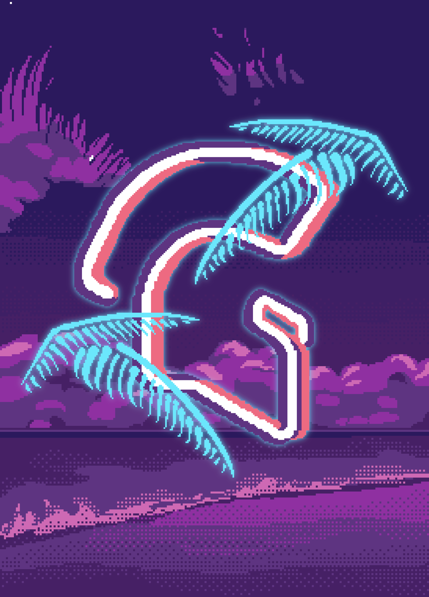
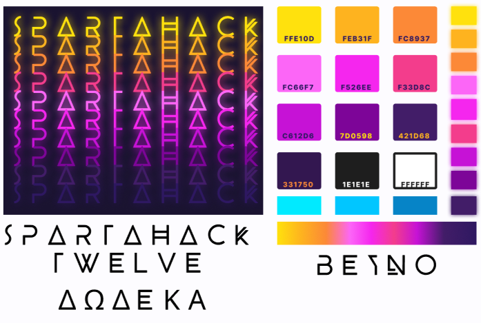

### Event Design & Web Prototyping  
**SpartaHack 12 – MSU 24-Hour Hackathon**  

SpartaHack is Michigan State University’s annual 24-hour hackathon, where hundreds of students collaborate to build apps, games, and other innovative projects. This year, I am the **Operations Team Co-Lead**. Our team is currently focused on behind-the-scenes event planning, as well as design and web prototyping for this year’s theme, **Pixel Vaper Wave**.

**Key Features:**  
- Designing custom pixel art assets and icons to establish a cohesive event theme  
- Prototyping a new layout and information architecture for this year’s website  
- Supporting brand consistency across web, social media, and merchandise  
- Collaborating with my team to plan events and challenges for this year’s hackathon  
 

**Development Process:**  
1. **Theme Concept:** Developing a retro pixel vaper wave aesthetic to define the event’s art theme and visual identity.  
2. **Pixel Asset Creation:**  
   - Designed event-specific icons, badges, and merchandise, including stickers and t-shirt designs.  
   - Created color palettes and visual motifs in style tiles to unify the event’s branding.  

3. **Web & UX Design:**  
   - Currently creating the landing page design and layout.
   - Curating future content and planning its management with the user experience in mind.
4. **Operations:**
   - Directing our team’s outreach and event design efforts.
   - Keeping the team on track with to-dos, outreach, and event design.
     
**Collaboration & Skills Applied:**  
- Cross-functional teamwork with marketing and event teams  
- UI/UX prototyping in Figma  
- Pixel art creation using Procreate and Illustrator  
- Event design coordination and iterative feedback integration  
- Leadership in organizing event tasks and operations  
- Speaker and event outreach for SpartaHack 12
